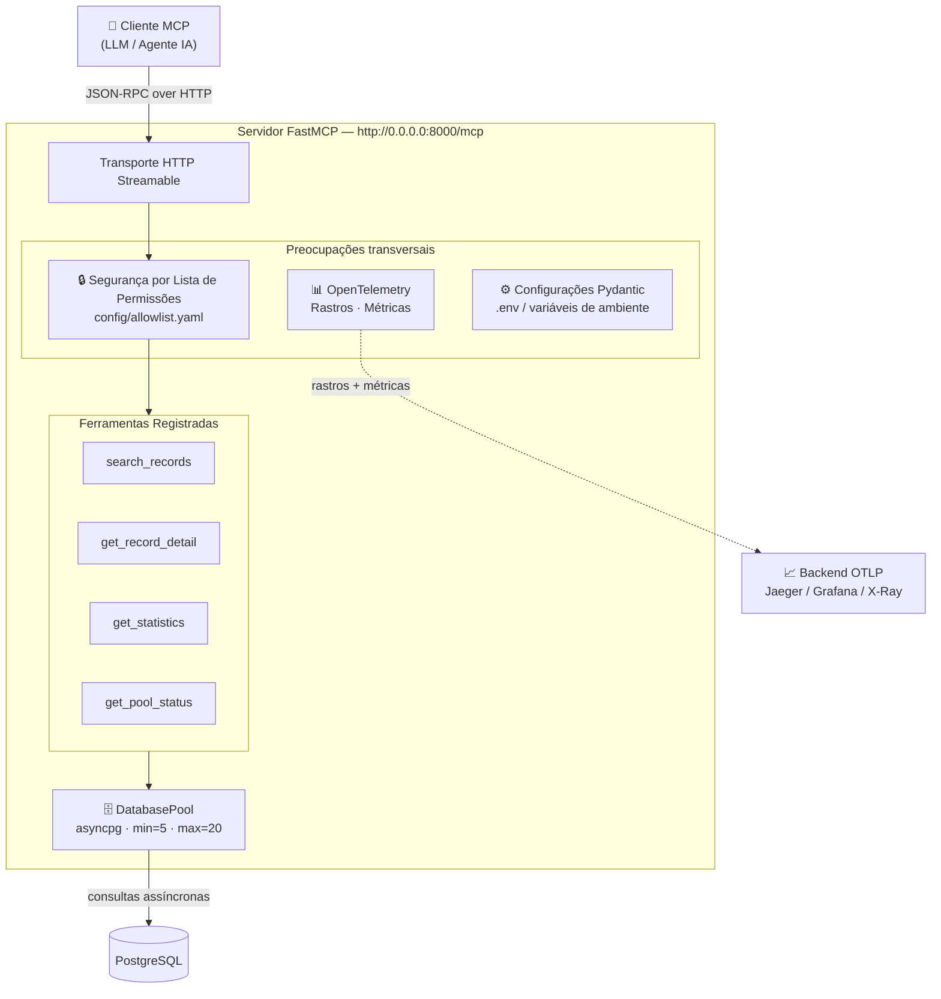
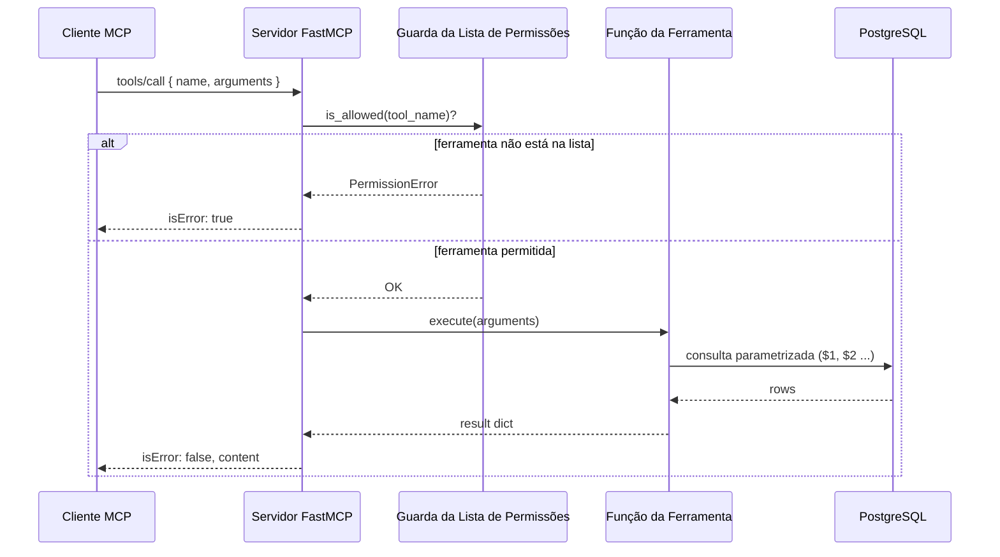
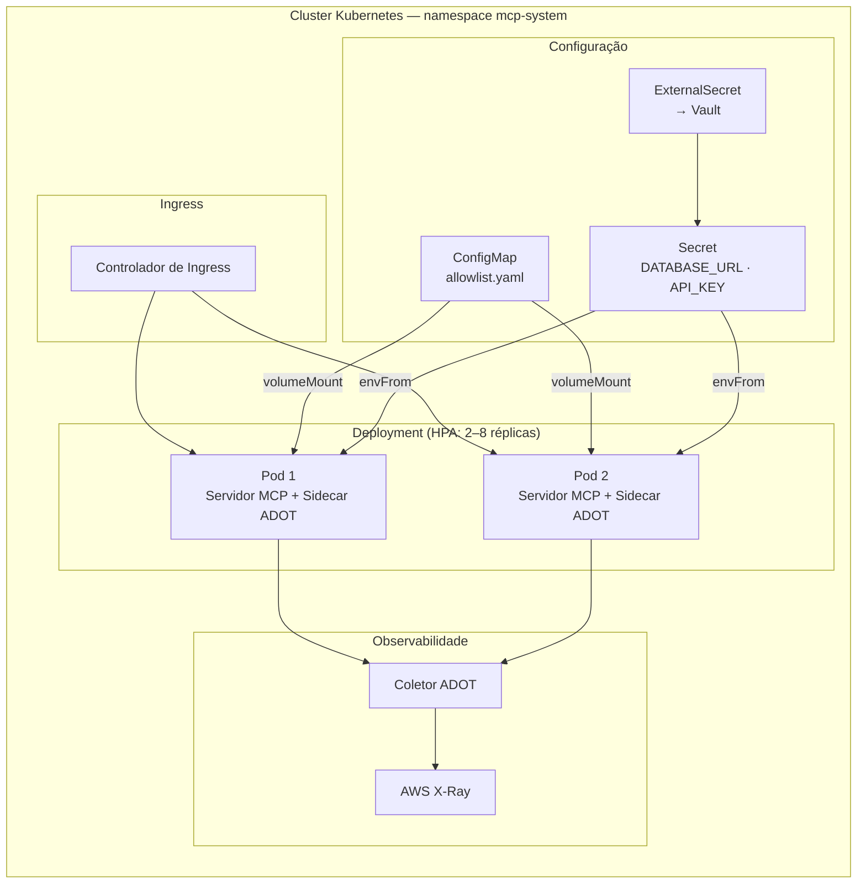
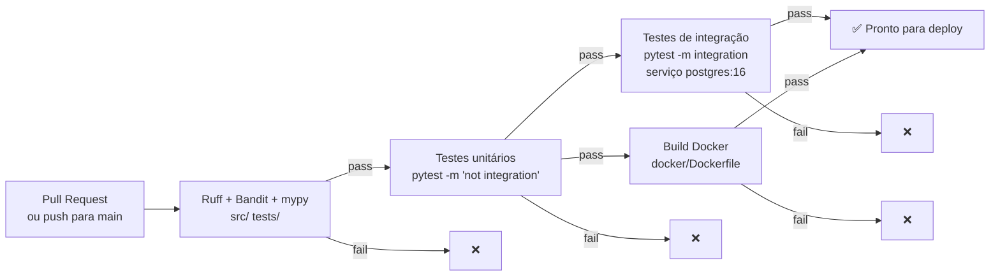
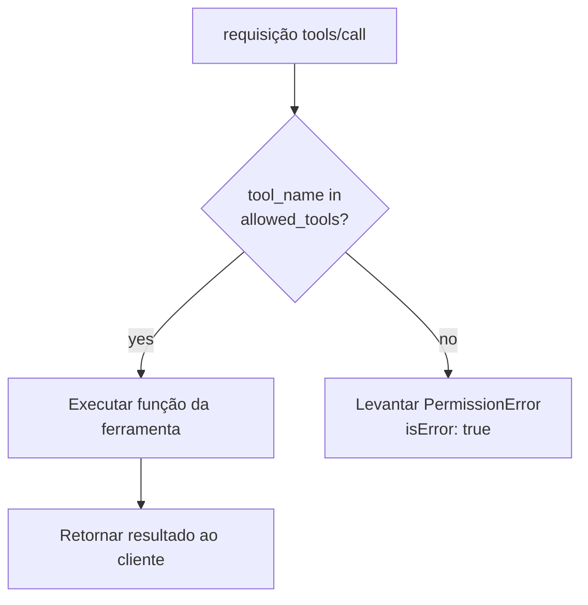
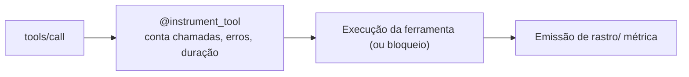
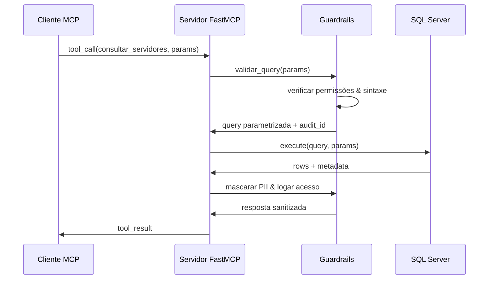
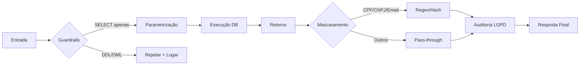

# 🏛️ Arquitetura MCP para Setor Público (fastmcp-public-service)

>Documento técnico completo contendo: ambiente Docker, documentação do sistema, diagramas, regras de Guardrails, integração de ferramentas de qualidade e prompt definitivo para o Agente Arquiteto de Software do Setor Público.
Importante: Em ambiente de desenvolvimento, banco utilizado SQL Server. Em Produção e Homologação, utilizo Postgresql. Camada adicional Kubernetes inserida para vislumbre dos pods.
---

# 📌 1. Servidor MCP - Características

## 1.1 Servidor MCP - Problemas/Backlog

* [x] Arquitetura Kubernetes para produção.
* [x] Gerenciar um pool de conexões de banco de dados com segurança entre chamadas assíncronas.
* [x] Impedir injeção de prompt via invocação não autorizada de ferramentas.
* [x] Rastreio na sua pilha de observabilidade - **caminho crítico**.

---


## 1.2 Funcionalidades para Produção

| Funcionalidade | Implementação |
|---|---|
| PostgreSQL assíncrono | Pool de conexão `asyncpg` (mín 5, máx 20), consultas parametrizadas |
| OpenTelemetry | Decorador `@instrument_tool` registra rastros + 4 métricas (`tool.calls`, `tool.errors`, `tool.duration`, `db.pool_size`) em cada chamada de ferramenta |
| Observabilidade multi‑backend | Configurações de coletor pré‑construídas para AWS ADOT → X‑Ray, stack Grafana LGTM e Datadog. Stack local com um comando: `make observe-up` |
| Segurança por lista de permissões | Lista de permissões baseada em YAML impede invocação não autorizada de ferramentas e injeção de prompt |
| Docker | Build multi‑stage, usuário não‑root (`mcpuser`), health check |
| Kubernetes | Chart Helm, HPA (2–8 réplicas), External Secrets Operator, sidecar ADOT opcional |
| CI/CD | GitHub Actions: Ruff + Bandit + mypy → testes unitários → testes de integração (serviço postgres) → build Docker |
| Configuração | Pydantic Settings, baseado em `.env`, compatível com 12‑factor |

---

## 1.3 Ambiente de Desenvolvimento 

### 🐳 1.3.1 Docker com SQL Server (se desejável)

### `Dockerfile.dev`
```dockerfile
FROM python:3.11-slim

WORKDIR /app

# Dependências do sistema para pyodbc e SQL Server
RUN apt-get update && apt-get install -y \
    curl \
    gnupg \
    unixodbc-dev \
    && curl https://packages.microsoft.com/keys/microsoft.asc | apt-key add - \
    && curl https://packages.microsoft.com/config/debian/11/prod.list > /etc/apt/sources.list.d/mssql-release.list \
    && apt-get update && ACCEPT_EULA=Y apt-get install -y msodbcsql17 \
    && rm -rf /var/lib/apt/lists/*

# Dependências Python
COPY pyproject.toml ./
RUN pip install --no-cache-dir -e ".[dev]"

# Copiar código
COPY . .

# Variáveis de ambiente padrão (sobrescrevíveis via docker-compose)
ENV SQL_SERVER_HOST=localhost
ENV SQL_SERVER_DB=publico_dev
ENV SQL_SERVER_USER=sa
ENV SQL_SERVER_PASSWORD=Dev@123456
ENV SQL_ENCRYPT=no
ENV SQL_TRUST_CERT=yes

# Porta padrão do MCP (JSON-RPC sobre SSE/Stdio)
EXPOSE 8000

CMD ["python", "-m", "mcp_server"]
```

### `docker-compose.yml`
```yaml
version: '3.9'
services:
  mcp-server:
    build:
      context: .
      dockerfile: Dockerfile.dev
    ports:
      - "8000:8000"
    environment:
      - SQL_SERVER_HOST=mssql
      - SQL_SERVER_DB=publico_dev
      - SQL_SERVER_USER=sa
      - SQL_SERVER_PASSWORD=<SENHA>
      - SQL_ENCRYPT=no
      - SQL_TRUST_CERT=yes
    depends_on:
      - mssql
    volumes:
      - .:/app
      - /app/.venv

  mssql:
    image: mcr.microsoft.com/mssql/server:2022-latest
    environment:
      - ACCEPT_EULA=Y
      - SA_PASSWORD=<SENHA>
      - MSSQL_PID=Express
    ports:
      - "1433:1433"
    volumes:
      - mssql_data:/var/opt/mssql
      - ./init-db.sql:/docker-entrypoint-initdb.d/init.sql

volumes:
  mssql_data:
```

### `init-db.sql` (Exemplo de estrutura segura)
```sql
CREATE DATABASE publico_dev;
GO
USE publico_dev;
GO
CREATE TABLE servidores (
    id INT PRIMARY KEY IDENTITY(1,1),
    nome VARCHAR(100) NOT NULL,
    cpf CHAR(11) NOT NULL,
    email VARCHAR(100) NOT NULL,
    lotacao VARCHAR(100),
    criado_em DATETIME2 DEFAULT SYSUTCDATETIME()
);
GO
-- Usuário com permissão mínima (apenas SELECT)
CREATE LOGIN mcp_user WITH PASSWORD = 'Mcp@Dev123';
CREATE USER mcp_user FOR LOGIN mcp_user;
GRANT SELECT ON servidores TO mcp_user;
GO
```

---


### 1.3.2 Início Rápido para Testar Observabilidade (Docker Compose comPostgresql + Stack Completo de Observabilidade)


### 

```bash
cp .env.example .env
make observe-up
```

Inicia o servidor MCP, PostgreSQL **e** a stack completa Grafana LGTM (OpenTelemetry Collector → Tempo → Prometheus → Grafana).

| Endpoint | URL |
|---|---|
| Servidor MCP | `http://localhost:8000/mcp` |
| Dashboards Grafana | `http://localhost:3000` (sem login) |
| Métricas Prometheus | `http://localhost:9090` |

`OTEL_ENABLED` é definido automaticamente como `true` ao usar este perfil de compose. Pare tudo com `make observe-down`.

---

## Arquitetura

### Visão Geral do Sistema



### 1.3.3 Ciclo de Vida da Requisição



### 1.3.4 Arquitetura de Deploy (Kubernetes)



### 1.3.5 Pipeline CI/CD



---

## ⚙ 2. Modelo de Segurança

Invocações de ferramentas são controladas por uma lista de permissões em YAML carregada na inicialização do servidor. Qualquer ferramenta que não esteja na lista gera `PermissionError` antes da execução — impedindo ataques de injeção de prompt onde um prompt malicioso tenta invocar uma ferramenta interna ou de depuração.



**Configuração da lista de permissões** (`config/allowlist.yaml`):

```yaml
allowed_tools:
  - search_records
  - get_record_detail
  - get_statistics
  # get_pool_status intencionalmente omitido — saúde está sempre acessível
```

**Uso do decorador**:

```python
@require_allowlist("search_records")
async def search_records(query: str, limit: int = 20) -> dict:
    ...
```

**Prevenção de injeção SQL** — duas camadas:
1. Todos os valores fornecidos pelo usuário usam consultas parametrizadas do `asyncpg` (`$1`, `$2`)
2. `get_statistics` valida `group_by` contra uma lista de colunas permitidas antes de construir a consulta
3. `search_records` valida as chaves de `filters` contra uma lista de colunas permitidas

---

## 🎯  3. Observabilidade

Cada chamada de ferramenta é automaticamente instrumentada via o decorador `@instrument_tool`. O decorador é a **camada mais externa** — registra todas as tentativas, inclusive chamadas bloqueadas pela lista de permissões.




-----

## 📊 4. Diagramas (Mermaid)

### 4.2 Fluxo de Operação (Tool Call)


### 4.3 Controle de Segurança & LGPD


---

## 🛡️ 5. Regras de Guardrails & Conformidade (LGPD/Segurança - Caminhos críticos observados)

| Categoria | Regra Técnica | Base Legal / Norma |
|-----------|---------------|-------------------|
| **Validação de Sintaxe** | Bloqueio de `INSERT`, `UPDATE`, `DELETE`, `DROP`, `EXEC`, `xp_` | Princípio da Mínimo Privilégio |
| **Prevenção de Injeção** | Obrigatório uso de `?` placeholders. Rejeição de strings interpoladas | OWASP ASVS 4.0.1 |
| **Mascaramento PII** | CPF: `***.***.***-XX`, CNPJ: `XX.XXX.XXX/XXXX-XX`, Email: `***@***.***` | LGPD Art. 5º, 6º, 46 |
| **Auditoria** | Log estruturado: `audit_id`, `usuario`, `query_hash`, `linhas_retornadas`, `timestamp_utc` | LGPD Art. 37, 43, 50 |
| **Retenção** | Respostas não são persistidas em cache. Logs rotacionados a 90 dias | LGPD Art. 46, ANPD Guia |
| **Criptografia** | TLS 1.2+ obrigatório. `Encrypt=yes` no driver. Chaves via `secrets` | NBR ISO 27001, LGPD Art. 46 |
| **Rate Limiting** | Máx 100 req/min por cliente. Timeout 15s por query | Resili


---
